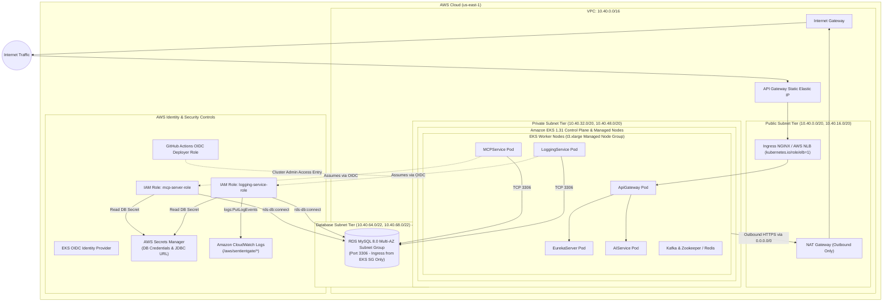

# SentientGate Infrastructure (Terraform)

Production-grade, modular Infrastructure as Code (IaC) for **SentientGate - AI-Powered Runtime Security for Cloud-Native Microservices**.

This Terraform configuration provisions a zero-trust, resilient AWS cloud foundation featuring a multi-tier Virtual Private Cloud (VPC), an Amazon Elastic Kubernetes Service (EKS 1.31) cluster with managed worker nodes, a private and isolated Amazon Relational Database Service (RDS MySQL 8.0) with AWS Secrets Manager integration, and IAM Roles for Service Accounts (IRSA) for least-privilege pod-level security.

---

## Table of Contents

- [Architectural Overview](#architectural-overview)
- [Architecture Diagram](#architecture-diagram)
- [Directory & Module Structure](#directory--module-structure)
- [Infrastructure Components Deep Dive](#infrastructure-components-deep-dive)
  - [1. Networking & VPC (`modules/vpc`)](#1-networking--vpc-modulesvpc)
  - [2. Public EIP Allocation (`modules/gateway_ip`)](#2-public-eip-allocation-modulesgateway_ip)
  - [3. Managed Kubernetes Cluster (`modules/eks`)](#3-managed-kubernetes-cluster-moduleseks)
  - [4. Private Database Layer (`modules/rds`)](#4-private-database-layer-modulesrds)
  - [5. Zero-Trust Identity & IRSA (`modules/iam`)](#5-zero-trust-identity--irsa-modulesiam)
- [Security & Defense-in-Depth Design](#security--defense-in-depth-design)
- [Prerequisites & Requirements](#prerequisites--requirements)
- [Input Variables Reference](#input-variables-reference)
- [Outputs Reference](#outputs-reference)
- [Step-by-Step Deployment Guide](#step-by-step-deployment-guide)
  - [1. Remote State Backend Configuration](#1-remote-state-backend-configuration)
  - [2. Variable Configuration](#2-variable-configuration)
  - [3. Provisioning Infrastructure](#3-provisioning-infrastructure)
  - [4. Post-Deployment Cluster Access](#4-post-deployment-cluster-access)
  - [5. Kubernetes ServiceAccount Annotations](#5-kubernetes-serviceaccount-annotations)
- [CI/CD & GitHub Actions Automation](#cicd--github-actions-automation)
- [Day-2 Operations & Maintenance](#day-2-operations--maintenance)
- [Clean-Up & Teardown](#clean-up--teardown)
- [Troubleshooting & FAQ](#troubleshooting--faq)

---

## Architectural Overview

SentientGate runtime infrastructure is engineered around core enterprise cloud principles:

1. **Strict Three-Tier Network Isolation**: Clear partition between public ingress routing, private container compute execution, and completely air-gapped database storage.
2. **Zero Inbound Internet Database Exposure**: RDS MySQL instances reside on subnets without Internet Gateway or NAT Gateway route table entries, ensuring zero direct external perimeter exposure.
3. **Least-Privilege Pod Identity (IRSA)**: Kubernetes workloads authenticate to AWS services (RDS DB Auth, Secrets Manager, CloudWatch) dynamically using OpenID Connect (OIDC) federated tokens instead of long-lived, hardcoded AWS access keys.
4. **Resilient Compute Auto-Scaling**: Worker nodes utilize AWS Managed Node Groups with on-demand EC2 instances distributed across availability zones, backed by the AWS EBS CSI driver for stateful workloads.
5. **Centralized Secrets Life Cycle**: Database master credentials and full JDBC connection strings are generated and stored directly in AWS Secrets Manager with automatic JSON formatting.

---

## Architecture Diagram



---

## Directory & Module Structure

```text
terraform/
├── main.tf                    # Root composition module orchestrating all infrastructure components
├── variables.tf               # Top-level input variable definitions with defaults and validation
├── outputs.tf                 # Top-level outputs exposing cluster, network, database, and IAM metadata
├── versions.tf                # Required Terraform CLI (>= 1.10.0), AWS/random providers, S3 backend
├── terraform.tfvars.example   # Sample input values for development and production environments
├── .terraform.lock.hcl        # Pinned provider dependency hashes
└── modules/
    ├── vpc/                   # Multi-AZ 3-tier networking, subnets, route tables, and NAT gateways
    │   ├── main.tf
    │   ├── variables.tf
    │   └── outputs.tf
    ├── gateway_ip/            # Static AWS Elastic IP dedicated for API Gateway / Ingress load balancing
    │   ├── main.tf
    │   ├── variables.tf
    │   └── outputs.tf
    ├── eks/                   # AWS EKS cluster, managed worker node groups, addons, and OIDC provider
    │   ├── main.tf
    │   ├── variables.tf
    │   └── outputs.tf
    ├── rds/                   # Private MySQL 8.0 RDS, parameter group, security group, and Secrets Manager
    │   ├── main.tf
    │   ├── variables.tf
    │   └── outputs.tf
    └── iam/                   # IRSA trust relationships and IAM policies for MCP and Logging pods
        ├── main.tf
        ├── variables.tf
        └── outputs.tf
```

---

## Infrastructure Components Deep Dive

### 1. Networking & VPC (`modules/vpc`)

Defined in [modules/vpc/main.tf](file:///home/shrihari/Documents/PersonalProjects/SentientGate--AI-Powered-Runtime-Security-for-Cloud-Native-Microservices/terraform/modules/vpc/main.tf):

- **CIDR & Subnetting Allocation**:
  - VPC CIDR: `10.40.0.0/16` (65,536 addresses).
  - Public Subnets (`10.40.0.0/20`, `10.40.16.0/20`): Host Internet Gateway, NAT Gateway, and external Load Balancers. Tagged with `kubernetes.io/role/elb = "1"` and `kubernetes.io/cluster/<cluster_name> = "shared"`.
  - Private Subnets (`10.40.32.0/20`, `10.40.48.0/20`): Host EKS worker nodes and elastic backend microservices. Tagged with `kubernetes.io/role/internal-elb = "1"`. Outbound internet is routed via NAT Gateway; direct inbound traffic from the internet is prohibited.
  - Database Subnets (`10.40.64.0/22`, `10.40.68.0/22`): Dedicated to data stores. Associated with an isolated route table with **no route to `0.0.0.0/0`**, guaranteeing complete network air-gapping from the internet.
- **NAT Gateway Optimization**: Supports `single_nat_gateway = true` (default) to reduce AWS baseline costs during development/staging, with support for multi-AZ NAT Gateways for high availability in mission-critical environments.
- **Database Subnet Group**: Automatically packages the database subnets into an `aws_db_subnet_group` spanning both availability zones.

### 2. Public EIP Allocation (`modules/gateway_ip`)

Defined in [modules/gateway_ip/main.tf](file:///home/shrihari/Documents/PersonalProjects/SentientGate--AI-Powered-Runtime-Security-for-Cloud-Native-Microservices/terraform/modules/gateway_ip/main.tf):

- Allocates a static AWS Elastic IP (`aws_eip`) with VPC domain binding.
- Tagged with `Role = "public-ingress"` and `kubernetes.io/cluster/<cluster_name> = "owned"`.
- Exposes `gateway_allocation_id` and `gateway_public_ip` for binding directly to AWS Network Load Balancer (NLB) or Ingress NGINX annotations.

### 3. Managed Kubernetes Cluster (`modules/eks`)

Defined in [modules/eks/main.tf](file:///home/shrihari/Documents/PersonalProjects/SentientGate--AI-Powered-Runtime-Security-for-Cloud-Native-Microservices/terraform/modules/eks/main.tf):

- **Module Source**: Upstream community-standard `terraform-aws-modules/eks/aws` (v20.31.6).
- **Cluster Version**: Kubernetes `1.31`.
- **API Endpoint Security**: Configurable public API access with CIDR restrictions (`cluster_endpoint_public_access_cidrs`).
- **Cluster Access Entries**: Employs the EKS Access Entry API (`enable_cluster_creator_admin_permissions = true`). If `github_actions_role_arn` is specified, an access entry is provisioned with `AmazonEKSClusterAdminPolicy` so GitHub Actions workflows can deploy without relying on legacy `aws-auth` ConfigMaps.
- **Cluster Add-ons**: Deploys managed add-ons with automatic update capabilities:
  - `coredns` (Internal DNS resolution)
  - `eks-pod-identity-agent` (EKS Pod Identity support)
  - `kube-proxy` (Kubernetes service networking)
  - `vpc-cni` (AWS VPC Native Pod Networking)
  - `aws-ebs-csi-driver` (Persistent Volume storage provisioning)
- **Managed Worker Node Group**:
  - Instance Type: `t3.xlarge` (ON_DEMAND).
  - Auto-scaling bounds: Minimum `1`, Desired `2`, Maximum `4`.
  - Storage: 40 GB encrypted GP3 root volumes.
  - Subnet Placement: Deployed strictly within private subnets.
  - Attached IAM Policies: `AmazonEBSCSIDriverPolicy` for CSI driver volume attachments.

### 4. Private Database Layer (`modules/rds`)

Defined in [modules/rds/main.tf](file:///home/shrihari/Documents/PersonalProjects/SentientGate--AI-Powered-Runtime-Security-for-Cloud-Native-Microservices/terraform/modules/rds/main.tf):

- **Engine**: MySQL Community Edition 8.0.
- **Instance Sizing & Storage**: `db.t3.micro` baseline with 20 GB GP3 storage, encrypted with AWS-managed KMS keys. Auto-scales storage dynamically up to 100 GB (`db_max_allocated_storage`).
- **Strict Network Isolation**: `publicly_accessible = false`, placed within the dedicated database subnet group.
- **Security Group Ingress Rules**: Port `3306/tcp` ingress is restricted specifically to `eks_node_security_group_id`. No other security group or CIDR block can reach the database.
- **Custom Parameter Group**: Configures `character_set_server = utf8mb4` and `collation_server = utf8mb4_unicode_ci` for full Unicode and emoji compatibility.
- **IAM Database Authentication**: `iam_database_authentication_enabled = true` enables token-based IAM authentication directly into MySQL for application pods.
- **AWS Secrets Manager Integration**: Generates a high-entropy 20-character master password via `random_password` and stores a structured JSON secret containing:
  ```json
  {
    "engine": "mysql",
    "host": "<rds-endpoint-hostname>",
    "port": 3306,
    "database": "sentientgate",
    "username": "sg_admin",
    "password": "<master-password>",
    "jdbc_url": "jdbc:mysql://<rds-endpoint>:3306/sentientgate?useSSL=true&requireSSL=true"
  }
  ```

### 5. Zero-Trust Identity & IRSA (`modules/iam`)

Defined in [modules/iam/main.tf](file:///home/shrihari/Documents/PersonalProjects/SentientGate--AI-Powered-Runtime-Security-for-Cloud-Native-Microservices/terraform/modules/iam/main.tf):

- **OIDC Federated Identity**: Bridges Kubernetes ServiceAccounts in the `sentientgate` namespace to AWS IAM roles using EKS OIDC provider trust policies.
- **MCP Server Role (`mcp-server-role`)**:
  - Assumed by ServiceAccount: `system:serviceaccount:sentientgate:mcp-server`.
  - Permissions:
    - `rds-db:connect` scoped to the RDS Resource ID (`arn:aws:rds-db:<region>:<account>:dbuser:<resource-id>/*`).
    - `secretsmanager:GetSecretValue` and `DescribeSecret` scoped to the DB secret ARN.
    - `rds:DescribeDBInstances`.
- **Logging Service Role (`logging-service-role`)**:
  - Assumed by ServiceAccount: `system:serviceaccount:sentientgate:logging-service`.
  - Permissions:
    - Same RDS connect and Secrets Manager permissions as above.
    - CloudWatch logging actions: `logs:CreateLogGroup`, `logs:CreateLogStream`, `logs:PutLogEvents`, and `logs:DescribeLogStreams` scoped strictly to `arn:aws:logs:<region>:<account>:log-group:/aws/sentientgate/*`.

---

## Security & Defense-in-Depth Design

| Security Layer | Implementation Details |
| :--- | :--- |
| **Perimeter Security** | Public API endpoint CIDRs can be restricted to corporate or runner egress IPs. All worker nodes and databases reside in private subnets. |
| **Network Micro-segmentation** | RDS MySQL is located in isolated subnets with no default internet gateway or NAT route, completely inaccessible from external networks. |
| **Host & Pod Isolation** | Security groups enforce ingress to RDS exclusively from the worker nodes' security group (`node_security_group_id`). |
| **Credential Hygiene** | Master database passwords are generated automatically and stored in AWS Secrets Manager; zero credentials are committed in source control. |
| **Identity & Access** | EKS Pods leverage IAM Roles for Service Accounts (IRSA) with scoped STS web identity assume-role trust conditions (`sub` and `aud`). |
| **Encryption in Transit & at Rest** | EBS volumes and RDS storage are encrypted with AWS KMS. MySQL enforces SSL connections via generated JDBC URLs (`useSSL=true&requireSSL=true`). |

---

## Prerequisites & Requirements

Before deploying, ensure you have the following CLI tools installed and configured:

1. **Terraform**: Version `>= 1.10.0`
   ```bash
   terraform version
   ```
2. **AWS CLI**: Version `v2`
   ```bash
   aws --version
   aws sts get-caller-identity
   ```
3. **kubectl**: Compatible with Kubernetes `1.31`
   ```bash
   kubectl version --client
   ```
4. **Helm**: Version `v3` (for deploying application manifests)
   ```bash
   helm version
   ```

---

## Input Variables Reference

All variables can be configured via [terraform.tfvars](file:///home/shrihari/Documents/PersonalProjects/SentientGate--AI-Powered-Runtime-Security-for-Cloud-Native-Microservices/terraform/terraform.tfvars.example) or passed using `-var` flags.

| Variable | Type | Default | Description |
| :--- | :--- | :--- | :--- |
| `aws_region` | `string` | `"us-east-1"` | AWS Region to deploy all infrastructure into. |
| `cluster_name` | `string` | `"sentientgate-eks"` | Base name applied to the EKS cluster, VPC, and AWS resources. |
| `github_actions_role_arn` | `string` | `null` | IAM role ARN assumed by GitHub Actions for cluster admin access. |
| `vpc_cidr` | `string` | `"10.40.0.0/16"` | Primary IPv4 CIDR block for the VPC. |
| `public_subnet_cidrs` | `list(string)` | `["10.40.0.0/20", "10.40.16.0/20"]` | Subnet CIDRs for public ingress and NAT Gateways. |
| `private_subnet_cidrs` | `list(string)` | `["10.40.32.0/20", "10.40.48.0/20"]` | Subnet CIDRs for EKS worker nodes and backend pods. |
| `database_subnet_cidrs` | `list(string)` | `["10.40.64.0/22", "10.40.68.0/22"]` | Subnet CIDRs for isolated RDS MySQL instances. |
| `single_nat_gateway` | `bool` | `true` | When `true`, uses 1 NAT Gateway to reduce cloud costs. Set `false` for multi-AZ HA. |
| `cluster_version` | `string` | `"1.31"` | Kubernetes control plane version. |
| `cluster_endpoint_public_access_cidrs` | `list(string)` | `["0.0.0.0/0"]` | IP CIDR blocks authorized to communicate with EKS API server. |
| `node_instance_types` | `list(string)` | `["t3.xlarge"]` | EC2 instance types for EKS managed worker nodes. |
| `node_min_size` | `number` | `1` | Minimum number of worker nodes in node group. |
| `node_max_size` | `number` | `4` | Maximum number of worker nodes in node group. |
| `node_desired_size` | `number` | `2` | Initial target count of worker nodes. |
| `node_disk_size` | `number` | `40` | Root EBS volume size in GB per worker node. |
| `db_name` | `string` | `"sentientgate"` | Initial database name inside RDS MySQL. |
| `db_username` | `string` | `"sg_admin"` | Master administrator username for MySQL. |
| `db_password` | `string` | `""` | Master DB password (leave empty to auto-generate securely). |
| `db_instance_class` | `string` | `"db.t3.micro"` | RDS compute and memory instance class. |
| `db_allocated_storage` | `number` | `20` | Baseline allocated storage in GB. |
| `db_max_allocated_storage` | `number` | `100` | Storage autoscaling upper limit in GB. |
| `db_engine_version` | `string` | `"8.0"` | MySQL engine version. |
| `db_skip_final_snapshot` | `bool` | `true` | Skip snapshot creation upon RDS deletion (`false` for prod). |
| `db_deletion_protection` | `bool` | `false` | Prevent accidental DB instance deletion (`true` for prod). |
| `kubernetes_namespace` | `string` | `"sentientgate"` | Target Kubernetes namespace hosting application pods. |
| `mcp_service_account_name` | `string` | `"mcp-server"` | Kubernetes ServiceAccount for MCP microservice. |
| `logging_service_account_name` | `string` | `"logging-service"` | Kubernetes ServiceAccount for Logging microservice. |

---

## Outputs Reference

Defined in [outputs.tf](file:///home/shrihari/Documents/PersonalProjects/SentientGate--AI-Powered-Runtime-Security-for-Cloud-Native-Microservices/terraform/outputs.tf):

| Output Name | Description | Downstream Usage |
| :--- | :--- | :--- |
| `cluster_name` | EKS cluster name. | Used with `aws eks update-kubeconfig`. |
| `cluster_endpoint` | EKS API server HTTPS endpoint. | Kubectl and CI/CD runner connection. |
| `cluster_arn` | EKS cluster ARN. | IAM and cross-service role associations. |
| `cluster_security_group_id`| Security group ID attached to control plane. | Cross-cluster security group rules. |
| `node_security_group_id` | Security group attached to worker nodes. | Referenced by RDS ingress rules. |
| `oidc_provider_arn` | EKS OIDC provider ARN. | Used by IRSA trust relationships. |
| `vpc_id` | ID of the created VPC. | Peering, Transit Gateway, or VPC Endpoints. |
| `public_subnet_ids` | IDs of public subnets. | External ALB and Ingress controllers. |
| `private_subnet_ids` | IDs of private subnets. | Worker nodes, Internal ALBs, KEDA scalers. |
| `database_subnet_ids` | IDs of isolated database subnets. | RDS replication and DB subnet expansion. |
| `gateway_public_ip` | Static IPv4 assigned for API Gateway Ingress. | DNS A-Record configuration. |
| `gateway_allocation_id` | AWS EIP Allocation ID. | NLB / Ingress NGINX annotations. |
| `rds_endpoint` | RDS MySQL connection endpoint (`host:port`). | Application environment configurations. |
| `rds_address` | Hostname of RDS MySQL instance. | Spring Boot `DATASOURCE_URL` configuration. |
| `rds_port` | Listening port for MySQL (`3306`). | Connection string assembly. |
| `rds_database_name` | Database name created in RDS. | Application DB setup. |
| `rds_resource_id` | RDS DB resource ID (e.g. `db-XYZ`). | Scoping `rds-db:connect` IAM policy. |
| `rds_credentials_secret_arn`| ARN of Secrets Manager secret. | Pod IRSA access and external-secrets integration. |
| `mcp_role_arn` | IAM Role ARN for MCP Server pod. | ServiceAccount annotation `eks.amazonaws.com/role-arn`. |
| `logging_role_arn` | IAM Role ARN for Logging Service pod. | ServiceAccount annotation `eks.amazonaws.com/role-arn`. |
| `mcp_service_account_annotations` | Key-value map of annotations for MCP SA. | Manifest and Helm template injection. |
| `logging_service_account_annotations` | Key-value map of annotations for Logging SA. | Manifest and Helm template injection. |

---

## Step-by-Step Deployment Guide

### 1. Remote State Backend Configuration

The configuration in [versions.tf](file:///home/shrihari/Documents/PersonalProjects/SentientGate--AI-Powered-Runtime-Security-for-Cloud-Native-Microservices/terraform/versions.tf) configures an S3 backend with native S3 state locking (`use_lockfile = true`, available in Terraform 1.10+):

```hcl
backend "s3" {
  key          = "sentientgate/terraform.tfstate"
  encrypt      = true
  use_lockfile = true
}
```

Create the state storage S3 bucket (or let your deployment automation provide it):

```bash
export AWS_REGION="us-east-1"
export STATE_BUCKET="sentientgate-tfstate-$(aws sts get-caller-identity --query Account --output text)"

aws s3api create-bucket \
  --bucket "${STATE_BUCKET}" \
  --region "${AWS_REGION}"

aws s3api put-bucket-versioning \
  --bucket "${STATE_BUCKET}" \
  --versioning-configuration Status=Enabled

aws s3api put-bucket-encryption \
  --bucket "${STATE_BUCKET}" \
  --server-side-encryption-configuration '{"Rules":[{"ApplyServerSideEncryptionByDefault":{"SSEAlgorithm":"AES256"}}]}'

aws s3api put-public-access-block \
  --bucket "${STATE_BUCKET}" \
  --public-access-block-configuration "BlockPublicAcls=true,IgnorePublicAcls=true,BlockPublicPolicy=true,RestrictPublicBuckets=true"
```

### 2. Variable Configuration

Create your `terraform.tfvars` from the provided example:

```bash
cd terraform
cp terraform.tfvars.example terraform.tfvars
```

Review and adjust variables according to your environment (e.g., node sizing, AWS region, or specific public access CIDRs).

### 3. Provisioning Infrastructure

Initialize, plan, and apply the infrastructure:

```bash
# Initialize Terraform with your S3 backend bucket
terraform init -backend-config="bucket=${STATE_BUCKET}" -backend-config="region=${AWS_REGION}"

# Validate syntax and configuration
terraform validate

# Review the execution plan
terraform plan -out=tfplan

# Apply the infrastructure
terraform apply tfplan
```

> [!NOTE]
> EKS cluster control plane creation and node group bootstrapping typically takes approximately 10 to 15 minutes.

### 4. Post-Deployment Cluster Access

Once `terraform apply` finishes, configure your local `kubectl` context:

```bash
aws eks update-kubeconfig \
  --region $(terraform output -raw aws_region 2>/dev/null || echo "us-east-1") \
  --name $(terraform output -raw cluster_name)

# Verify node health and readiness
kubectl get nodes -o wide

# Verify system pods and addons
kubectl get pods -n kube-system
```

### 5. Kubernetes ServiceAccount Annotations

To connect your deployed Kubernetes microservices with their provisioned AWS IAM roles via IRSA:

```bash
export MCP_ROLE_ARN=$(terraform output -raw mcp_role_arn)
export LOGGING_ROLE_ARN=$(terraform output -raw logging_role_arn)

cat <<EOF | kubectl apply -f -
apiVersion: v1
kind: Namespace
metadata:
  name: sentientgate
---
apiVersion: v1
kind: ServiceAccount
metadata:
  name: mcp-server
  namespace: sentientgate
  annotations:
    eks.amazonaws.com/role-arn: "${MCP_ROLE_ARN}"
---
apiVersion: v1
kind: ServiceAccount
metadata:
  name: logging-service
  namespace: sentientgate
  annotations:
    eks.amazonaws.com/role-arn: "${LOGGING_ROLE_ARN}"
EOF
```

When pods run with these ServiceAccounts, the EKS Pod Identity Webhook automatically injects `AWS_ROLE_ARN` and `AWS_WEB_IDENTITY_TOKEN_FILE` environment variables, allowing the AWS SDK inside your services to assume the role transparently.

---

## CI/CD & GitHub Actions Automation

SentientGate includes an automated release workflow in [.github/workflows/release-deploy.yml](file:///home/shrihari/Documents/PersonalProjects/SentientGate--AI-Powered-Runtime-Security-for-Cloud-Native-Microservices/.github/workflows/release-deploy.yml).

The pipeline operates as follows:

1. **Idempotent Cluster Verification**: When a GitHub Release is published, the workflow checks if the EKS cluster already exists in AWS.
2. **Conditional Terraform Provisioning**:
   - If the cluster is absent, it securely bootstraps the S3 backend, initializes Terraform, and applies the complete infrastructure.
   - It binds the GitHub Actions OIDC deployment role directly to the EKS Access Entry API via `github_actions_role_arn` (`AmazonEKSClusterAdminPolicy`).
3. **Application Rollout**: Once infrastructure is healthy, Helm deploys the microservice suite into the `sentientgate` namespace using digest-pinned container images signed with keyless Cosign.

For comprehensive details on GitHub Actions secrets, OIDC trust configuration, and variable setup, refer to [AWS-CD-SETUP.md](file:///home/shrihari/Documents/PersonalProjects/SentientGate--AI-Powered-Runtime-Security-for-Cloud-Native-Microservices/AWS-CD-SETUP.md).

---

## Day-2 Operations & Maintenance

### Worker Node Scaling

You can scale the EKS managed node group dynamically without disrupting running workloads:

```bash
# In terraform.tfvars:
node_desired_size = 3
node_max_size     = 6

# Apply changes
terraform apply -target=module.eks.module.eks_managed_node_group
```

### Retrieving Database Credentials

To inspect the generated credentials stored in Secrets Manager:

```bash
SECRET_ARN=$(terraform output -raw rds_credentials_secret_arn)

aws secretsmanager get-secret-value \
  --secret-id "${SECRET_ARN}" \
  --query SecretString \
  --output text | jq .
```

### Rotating RDS Master Credentials

AWS Secrets Manager supports rotating credentials. If you manually rotate or update the secret, restart the dependent pods to pick up new tokens:

```bash
kubectl rollout restart deployment mcp-service -n sentientgate
kubectl rollout restart deployment logging-service -n sentientgate
```

---

## Clean-Up & Teardown

> [!WARNING]
> Before running `terraform destroy`, you **MUST** uninstall any Kubernetes workloads that create AWS load balancers or PersistentVolumeClaims (EBS volumes). If Kubernetes leaves orphaned ENIs or Security Groups in the VPC, Terraform destruction will fail with dependency violation errors.

Follow this teardown sequence:

```bash
# 1. Uninstall Helm release and delete Ingress / Load Balancers
helm uninstall sentientgate -n sentientgate || true
kubectl delete ingress --all -n sentientgate || true
kubectl delete svc --all -n sentientgate || true

# Wait 2-3 minutes for AWS Load Balancer Controller to release ELBs and ENIs

# 2. Check and disable RDS deletion protection if active
terraform apply -var="db_deletion_protection=false" -auto-approve

# 3. Destroy all Terraform-managed resources
terraform destroy
```

---

## Troubleshooting & FAQ

### 1. `Error: getting RDS DB Instance: AccessDenied` or IRSA Auth Failures
- **Symptom**: Application pod fails to connect to MySQL via IAM database authentication.
- **Cause**: The IAM role trust policy condition must match the Kubernetes namespace and ServiceAccount name exactly.
- **Fix**: Verify `terraform output mcp_service_account_annotations` matches your pod's ServiceAccount name and namespace (`sentientgate:mcp-server`). Also verify MySQL has the user configured with `IDENTIFIED WITH AWSAuthenticationPlugin`.

### 2. Pods Cannot Reach RDS MySQL (`Connection Timeout`)
- **Symptom**: Pod logs show `Communications link failure` on port `3306`.
- **Cause**: Pod is not running on an EKS worker node associated with `node_security_group_id`, or database subnet route tables are misconfigured.
- **Fix**: In `modules/rds/main.tf`, verify `aws_security_group.rds` allows ingress from `module.eks.node_security_group_id`. Ensure the pods are scheduled onto the worker nodes managed by the cluster.

### 3. Load Balancer Subnet Discovery Errors
- **Symptom**: AWS Load Balancer Controller fails to create an Ingress ALB/NLB.
- **Cause**: Missing subnet tags required by Kubernetes.
- **Fix**: The VPC module automatically applies:
  - Public Subnets: `kubernetes.io/role/elb = 1`
  - Private Subnets: `kubernetes.io/role/internal-elb = 1`
  - Cluster tag: `kubernetes.io/cluster/<cluster_name> = shared`
  Ensure you have not overridden or stripped these subnet tags in custom overrides.

### 4. S3 Backend Lock Conflict
- **Symptom**: `Error acquiring the state lock`.
- **Cause**: A previous Terraform run was interrupted before releasing its lockfile.
- **Fix**: Inspect the S3 state bucket lock file or unlock with:
  ```bash
  terraform force-unlock <LOCK_ID>
  ```
